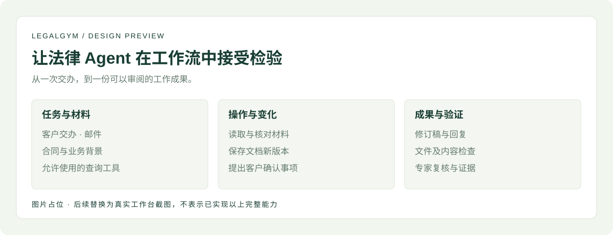
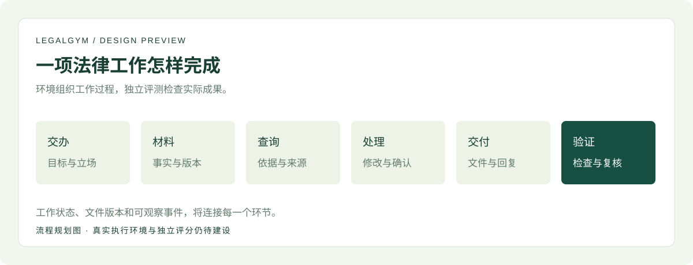
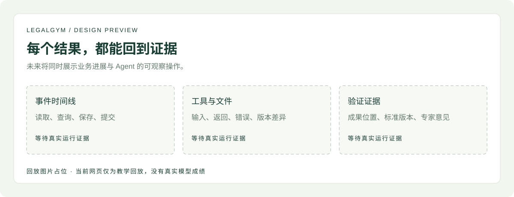

# LegalGym · 法律 Agent 工作环境

[访问当前网站](https://amasawasama.github.io/LegalGym/) · [Agent 实验室与回放](https://amasawasama.github.io/LegalGym/lab/?example=1&tab=log)

实验室按“查看已有运行、运行示例 Agent、接入自己的 Agent”组织入口，默认打开执行日志。静态站内置参考运行摘要，并按需载入约 40 KB 的日志与步骤；截图和 Word 独立加载，超时可重试。无需安装或密钥，且隐藏不可用的启动控件。新任务可使用 [自动配置启动包（预览版）](downloads/legalgym-quickstart.zip)，解压运行后自动准备本机依赖；仍需自己的模型 API Key。

当前网站提供合同任务示例、真实运行日志与交互回放、修订 Word 全部页面预览、回放包导入及下载。
GitHub Pages 仅展示静态内容；新任务需在使用者本机启动任务后端和独立 starter。网页中可下载 starter 和 [完整本机项目](downloads/legalgym-source.zip)。

静态网站直接位于仓库根目录；沿用现有 Pages 发布方式。模型密钥、本机环境和个人运行目录均未上传。
此前的框架文档、贡献说明及原型资料保留如下，相关进度描述以当前网站为准。

---

# LegalGym

**让法律 Agent 在中国律师工作流中完成任务，交出可审阅的成果。**

*A work environment and evaluation framework for legal agents in Chinese legal practice.*

[体验原型](#体验当前原型) · [了解工作流](#从一份客户交办开始) · [当前进度](#从合同审查起步) · [参与建设](#一起建设-legalgym)

> **交互原型阶段。** 当前可浏览任务、体验教学工作台和示意回放；真实 Agent 运行与正式评分仍在建设计划中。

## 为什么做 LegalGym

律师接到的往往是一封邮件、一份合同和几份背景材料。完成工作，需要理解客户立场、核对关联事实、处理修改和授权，最后把判断落实到文件。

LegalGym 希望将这些环节连接成可操作、可重置的工作环境，让不同 Agent 在一致条件下完成任务，并由文件检查和专业律师共同验证成果。

## 从一份客户交办开始

**客户发来一份维修合同。**

交办只覆盖部分部件，合同却要求整机性能承诺；附件中还有报价和技术说明。

Agent 需要核对这些材料，将处理建议落实到修订稿，并把超出授权的事项交给客户确认。任务结束后，评测者检查实际交付，律师再复核关键判断。

这是原型中的教学改写。它说明我们希望怎样组织任务，不是原题材料或权威法律意见。

**在事项中工作**  
邮件、合同、背景材料和工具共同构成工作现场。我们希望观察 Agent 能否理解关联信息，并将修改保存到实际文件。

**让成果留下证据**  
查询、文件变化和最终提交应能被追溯。未来回放将同时呈现业务进展、工具反馈与交付证据，帮助定位错误。

**由专业判断校准**  
律师独立审查、解释依据、发现遗漏，并指出哪些不同方案同样合理。评测标准应区分法律要求、客户偏好和专业习惯。

展开：我们希望怎样展示一次真实运行？

观众可以从两个视角观看同一项工作：

- **业务视角**：从交办到交付，工作推进到了哪里。
- **执行视角**：Agent 使用了什么工具、收到了什么结果、修改了哪些文件。

最终报告再关联交付物与评分依据。当前网页是四步预设教学回放，不是实际模型轨迹；上图也是设计占位。

## 从合同审查起步

项目内部已构建 **6 道合同任务、95 个参考审查点**，另有两项“只给合同”的附加对照。本仓库展示任务元数据；参考点数量不代表已经完成正式专家审定。

- [x] 六题目录、检索与材料清单
- [x] 教学工作台、模拟文件下载和本机草稿
- [x] 示意回放、配置草案及专家意见草稿
- [ ] 真实 Agent 接入、工具服务与独立运行实例
- [x] 已收到采购、维修任务的部分审题与答卷反馈
- [ ] 反馈复核、标准校准及完整评测验证
- [ ] 查询、客户确认、多轮版本与正式排行榜

展开：六道题分别是什么？

- **C01 · 粮食采购合同**：9 个参考审查点。
- **C02 · 仪器维修合同**：12 个参考审查点。
- **C03 · 搬运服务合同**：10 个参考审查点。
- **C04 · 节水管理服务合同**：23 个参考审查点。
- **C05 · 论坛物料印刷合同**：14 个参考审查点。
- **C06 · 全过程咨询合同**：27 个参考审查点。

C05、C06 有“只给合同”附加条件，不计为新增题目。完整合同、隐藏标准和专家参考没有包含在本仓库中。

首页用匿名改写的复核案例解释标准校准、修改质量及分层评价。个别反馈不代表专家共识，意见收集也不等于已完成修题。

近期先跑通一项可复现的工作，再扩展任务和工具。详细状态见 [环境与建设明细](docs/环境与建设明细.md)，页面关系见 [网站框架大纲](网站框架大纲.md)。

## 体验当前原型

下载仓库，双击根目录的 **`index.html`** 即可打开。Mac 也可使用 `打开网页-Mac.command`，无需安装依赖或联网。

你可以浏览六题、查看模拟材料、体验回放，并保存或下载草稿。草稿仅保存在本机，不会发送给项目团队。

当前没有在线部署，也没有可运行的 Agent 评测端点；“评测接入”只能下载配置草案。操作细节见 [本地使用说明](docs/本地使用说明.md)。

## 一起建设 LegalGym

**你是律师？**  
讲述一个熟悉的工作事项，独立审查一道题，或解释关键修改的依据与其他合理方案。专业判断帮助我们发现仅靠材料无法看出的遗漏。

**你是法学生或研究助理？**  
协助整理口述、材料目录和明确依据，将草案交给相关领域专家确认。

**你是开发者？**  
帮助接入文档工具、保存操作轨迹、构建可重置环境，或验证模型与 Harness 的运行方式。

**你来自律所、法学院或研究机构？**  
与我们共同定义专业场景、组织重复审查，或探索用私有数据在本地环境中评测。

从 [贡献指南](CONTRIBUTING.md) 或 [事项贡献模板](docs/事项贡献模板.md) 开始。仓库开放后，可通过 Issue 讨论场景，通过 Pull Request 提交文档与代码。当前网页表单只生成本机草稿。

材料范围、复现与专业意见怎样处理？

本仓库包含网页原型、元数据、教学示例和设计文档，不包含真实合同正文、隐藏参考答案、审核数据库或凭证。

正式贡献材料前，确认来源、脱敏情况及评测、训练、论文和公开展示的用途。专业意见保留适用条件、对应版本与采纳说明；存在分歧时，不简单用多数票替代判断。

未来结果需记录任务、模型、Harness、环境与评分版本，以及工具权限、预算和裁判配置。文件／工具接口与浏览器操作路线分别报告成绩。

正式数据及代码许可范围尚待确认。原型验证范围见 [使用说明](docs/本地使用说明.md)。

---

设计借鉴：[Agentic-City](https://github.com/FreedomIntelligence/Agentic-City) · [TwinHospital2](https://github.com/FreedomIntelligence/twinhospital2) · [NumericBridge](https://github.com/FreedomIntelligence/NumericBridge) · [OmniDentBench](https://github.com/FreedomIntelligence/OmniDentBench)。这些链接不表示合作或背书。
