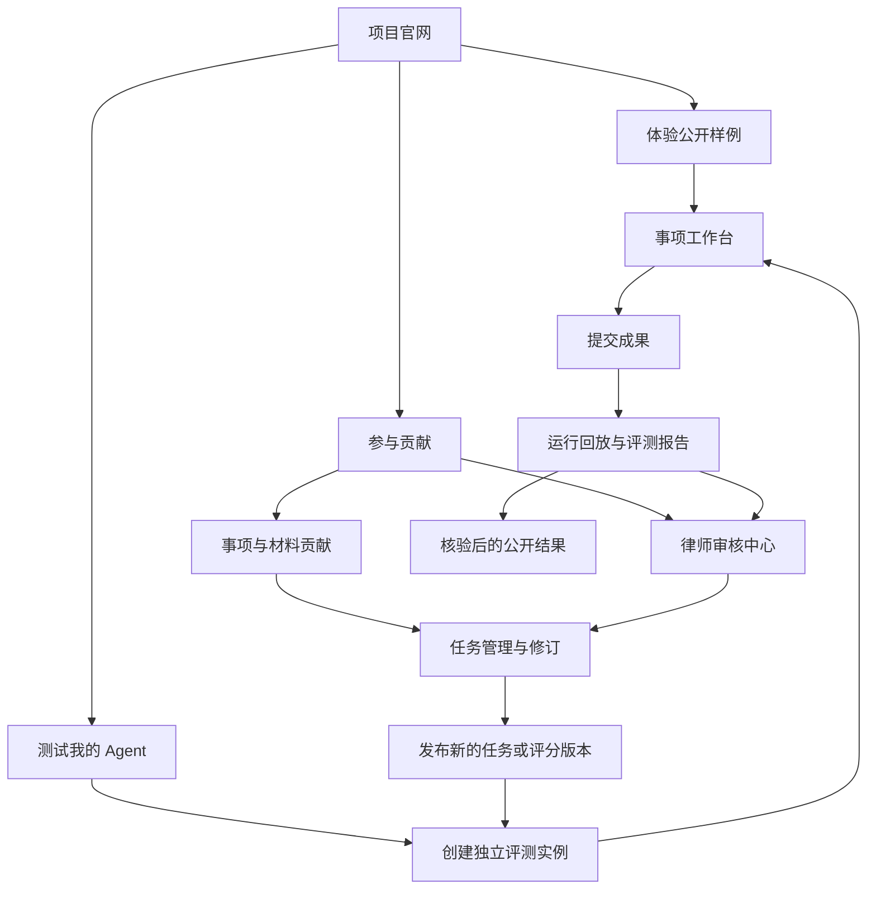

# 法律 Agent 评测网站框架大纲

整理日期：2026-11-21  
依据：前期项目讨论、老师会议转写、律师需求及现有审核网站。  
用途：供组会讨论、网页设计与开发拆分使用。  
状态：设计建议，不代表所有模块已经实现。项目名称暂用 **Legal Gym｜中国法律工作流评测环境**。

## 1. 项目定位与整体关系

网站服务三个目标：

1. **对外介绍与协作**：说明项目做什么，吸引律所、法学院、模型公司及开发者参与。
2. **Agent 工作与评测**：提供可操作、可重置的法律工作环境，运行 Agent 并记录结果。
3. **专家验证与题库维护**：让律师贡献事项、独立审查、复核标准及模型成果，推动修题。

核心展示是一项工作从“收到客户交办”到“交出可审阅成果”的全过程。官网是入口；真正的测试还需要文件、工具、状态服务和独立评分系统。



### 1.1 三种内容边界

| 内容 | 主要用户 | 可见范围 |
|---|---|---|
| 项目介绍、公开样例、接入文档 | 访客、研究者、合作方 | 公开 |
| 交办、输入材料、允许使用的查询与工具、工作成果 | 被测 Agent、运行者 | 本次任务授权的工作区 |
| 专家参考、隐藏评分标准、争议记录、管理数据 | 律师、评分服务、管理员 | 按任务与角色授权 |

公开学习样例可以展示参考答案；正式测试的参考材料由评分端单独保存，不能只靠前端隐藏。

## 2. 用户与入口

| 用户 | 主要需求 | 入口 |
|---|---|---|
| 普通访客、潜在合作方 | 看懂项目及实际运行方式 | 体验一个事项 |
| 研究者、模型公司、Agent 开发者 | 接入自己的系统、复现结果 | 测试我的 Agent |
| 专业律师 | 贡献工作流、独立审查、复核成果 | 参与贡献／专家审核 |
| 法学生及研究助理 | 整理材料、按明确清单核对、辅助组织 | 分配的贡献任务 |
| 工程贡献者 | 增加环境、工具、适配器和检查程序 | 代码与工具贡献 |
| 项目管理员 | 分配、修题、版本发布、结果核验 | 管理后台 |

身份、专业领域、参与角色分别记录；学生核对结果与律师专业判断在分析时保留区别。

## 3. 网站信息架构

```text
项目官网
├── 首页
├── 任务与环境
│   ├── 场景目录
│   ├── 任务详情
│   └── 工具与环境介绍
├── 体验演示
│   ├── 样例选择／启动
│   ├── 事项工作台
│   └── 运行回放
├── 运行评测
│   ├── 快速开始与接入文档
│   ├── 创建评测
│   ├── 我的运行
│   └── 结果报告
├── 结果与研究
│   ├── 排行榜
│   ├── 评测方法
│   └── 版本与更新
├── 参与贡献
│   ├── 贡献指南
│   ├── 讲述／提交事项
│   ├── 我的贡献
│   └── 机构合作
└── 专业入口
    ├── 律师任务中心
    ├── 独立盲审
    ├── 参考意见审核
    ├── 模型答卷复核
    ├── 争议处理
    └── 项目管理后台
```

“页面”是逻辑划分，可以采用独立页面、标签页或抽屉；第一版无需全部拆成独立网页。

## 4. 公共官网板块

### 4.1 首页

**作用**：快速回答“是什么、已能做什么、怎样使用、怎样加入”。

| 板块 | 内容 | 可能的形式 | 按钮与作用 | 关联 |
|---|---|---|---|---|
| 顶部导航 | 项目名、主要入口、语言 | 固定导航栏 | 中文／English；GitHub；登录 | 全站 |
| 首屏定位 | 中国法律工作流中的 Agent 评测环境 | 简短文案＋工作台实景 | 体验事项；测试我的 Agent；参与贡献 | 三条主要路径 |
| 运行演示 | 交办、操作、交付及一个失败点 | 60–90 秒视频／交互回放 | 播放；查看完整运行 | 回放页 |
| 工作流程 | 交办→材料→查询→修订→确认→交付→评测 | 流程图 | 查看环境 | 环境介绍 |
| 当前覆盖 | 场景、材料、工具、交付形式 | 能力卡片 | 浏览任务 | 场景目录 |
| 项目进展 | 样例、专家审核、版本、招募 | 时间线／更新列表 | 全部更新 | 版本页 |
| 合作入口 | 各类参与者可以提供什么 | 角色卡片 | 申请合作；贡献指南 | 贡献中心 |
| 页脚 | 团队、引用、联系方式、许可证及数据说明 | 链接区 | 对应链接 | 文档与合作页 |

示例文案：**让法律 Agent 在中国律师工作流中接受检验。从客户交办、材料核查到合同修订，评估它能否交出律师可审阅的成果。**

统计分开显示：已构建、专家已审核、公开样例、保留测试任务。未实现功能标注规划中，不把演示动画当作真实运行证据。

### 4.2 场景目录

**内容**：任务卡片包含合同／业务类型、代表方、材料类型、交付物、交互能力、审核状态与公开状态。

**形式**：筛选栏＋卡片／表格，可切换视图。

筛选：业务领域、审查／起草／版本比较／事实整理、文件／检索／网页／客户确认、材料格式、审核状态、开放状态。

按钮：

- **查看详情**：进入任务公开信息。
- **体验样例**：进入授权公开的事项实例。
- **查看回放**：观看既有运行。
- **下载公开任务包**：获取允许公开的材料。
- **贡献类似场景**：预填场景类别进入贡献表单。

正式测试可只展示分类与统计，不公开具体材料及参考标准。

### 4.3 任务详情

| 板块 | 内容／形式 |
|---|---|
| 任务简介 | 代表方、目标、范围、期限，摘要卡片 |
| 材料清单 | 文件名、类型、版本、用途，文件列表 |
| 工具与交互 | 允许查询和操作，工具卡片 |
| 交付要求 | 格式、命名、修订／批注要求，清单 |
| 运行条件 | 接入方式、预算、联网范围，配置摘要 |
| 数据说明 | 真实与合成构成、适用时间、开放范围 |
| 版本与审核 | 版本号、审核状态、更新记录 |

按钮：开始体验、查看运行示例、接入文档、报告任务问题。学习样例可提供“查看专家参考”；正式测试使用独立实例和隐藏标准。

### 4.4 工具与环境介绍

介绍 Agent 可以观察什么、操作什么，以及操作会改变什么。用“工具名称—输入—返回—状态变化”的示例说明文件、邮件、查询、版本、确认和交付能力。

按钮：查看接口文档、运行最小示例、查看版本支持、报告工具问题。

## 5. Agent 事项工作环境

### 5.1 启动页

显示任务版本、材料与查询库版本、接入模式、工具权限、预算及交付要求。

按钮：人工体验、运行示例 Agent、接入我的 Agent、开始运行、返回详情。

明确区分人工体验、教学示意、真实 Agent 运行。每次正式运行创建独立实例。

### 5.2 工作台布局

```text
顶部：事项名称｜运行状态｜预算｜帮助｜提交成果

左侧导航          中间工作区                    右侧状态栏
任务交办          当前邮件／合同／查询结果       当前文件版本
收件箱                                        待确认事项
事项文件                                      已保存成果
查询中心                                      最近操作
客户确认
交付区
```

侧栏可收起；状态栏只呈现工作状态，不显示隐藏考点或提示“还剩几个风险”。

### 5.3 工作台模块、内容与按钮

| 模块 | 内容 | 形式 | 按钮与作用 | 关联 |
|---|---|---|---|---|
| 任务交办 | 代表方、目标、范围、期限、交付要求 | 交办卡＋完整说明 | 查看交办；打开附件；查看规则 | 邮件、材料、交付 |
| 收件箱 | 邮件链、正文、附件、时间、草稿 | 邮件列表＋阅读区 | 打开；下载附件；保存回复草稿；提交确认；查看往来 | 文件、客户确认 |
| 事项文件 | 输入、工作文件、相关协议及版本 | 文件树＋列表 | 搜索；预览；下载；上传工作版本；新建文件夹；查看／比较版本 | 文档查看器、交付 |
| 文档查看器 | 合同正文、修订、批注、前后差异 | 全文预览＋对比视图 | 搜索；跳条款；显示修订／批注；下载原文件；上传修改稿；版本对比 | 文件与回放 |
| 查询中心 | 法律资料、模拟企业信息、内部材料 | 搜索框＋筛选＋结果详情 | 搜索；按时间筛选；查看原文／来源；保存引用 | 内容判断与成果 |
| 客户确认 | 待核实事实、待授权条件、方案及回复 | 状态列表＋对话／表单 | 新建；提交询问；查看回复；标记已处理 | 交办、修订、交付 |
| 交付区 | 必交文件、所选版本、交付说明 | 文件清单＋状态 | 添加／替换；预览；完整性检查；填说明；最终提交 | 冻结成果并启动评分 |

实施要点：

- 第一版使用下载、上传、预览和对比，无需先开发完整在线 Word 编辑器。
- 保留输入原件，修改生成新版本。保存必须对应真实文件或状态变化。
- 草稿、请求确认、模拟发出是不同状态。
- 查询资料记录来源与适用时间；封闭资料库明确范围。
- 模拟客户采用固定事实及回复规则；事实未知时允许返回未知，不临场编造答案依据。
- 文件检查仅检查格式、存在性、能否打开等，不泄露隐藏评分要求。
- 不规定唯一操作顺序；除任务明确要求外，允许不同合理路径。

### 5.4 环境文件与服务

```text
Agent 可访问的事项工作区/
  任务说明.txt
  收件箱/客户交办.eml
  输入材料/待审合同.docx
  输入材料/报价.csv
  工作文件/
  交付文件/

评分与管理服务单独保存/
  评分标准
  专家参考及可接受方案
  模拟客户规则
  运行日志与文件快照
```

配套服务包括：文件与版本管理、邮件状态、固定查询库、客户事件规则、运行控制、轨迹记录及独立评分。网页和 API 可连接同一份状态，评分权限另外隔离。

## 6. 开发者接入与运行

### 6.1 快速开始与接入文档

回答五个问题：怎样启动独立实例；怎样获取任务和材料；怎样连接模型与 Harness；怎样提交；怎样获取并复现结果。

形式：步骤教程＋最小运行示例＋工具文档＋常见错误。

支持路线：

| 模式 | 操作形式 | 评测重点 |
|---|---|---|
| 文件＋工具接口 | 文件系统、API；按需提供 MCP | 法律处理与任务执行 |
| 浏览器操作 | 点击、搜索、下载、上传 | 包含办公界面操作的任务能力 |

两种模式分开报告，不直接混排成绩。

### 6.2 创建评测

字段：模型及版本、Harness 版本、接入模式、工具权限、任务集、重复次数、预算、本地／托管运行。

按钮：下载配置模板、验证连接、试跑公开样例、开始批量评测。

本地模式自行保管密钥；托管模式通过受保护配置入口处理，不将密钥写入共享日志。

### 6.3 我的运行

形式：运行列表＋进度详情。字段：运行编号、任务与配置版本、开始时间、完成数、成本、状态。

状态：排队、运行中、等待回复、完成、预算耗尽、工具失败、评分失败、已停止。

按钮：查看进度、停止、查看报告、下载日志与成果、按相同配置重新运行。暂停／恢复仅在完整保存状态后提供。

## 7. 演示、回放与报告

### 7.1 三种演示形式

| 形式 | 展示方式 | 用途 |
|---|---|---|
| 短视频 | 60–90 秒真实运行剪辑 | 首页快速理解 |
| 交互回放 | 播放、暂停、逐步、跳转，联动材料与版本 | 核心证据展示及复核 |
| 实时运行 | 公开样例运行，事件持续更新 | 后续体验功能 |

演示展示可观察动作、工具返回和成果变化；不要求展示内部推理。事后解说标明为说明，预设动画标明为流程示意。

### 7.2 回放页

三栏布局：**事件时间线｜调用与返回内容｜文件／事项变化**。

按钮：播放、暂停、上一步、下一步、速度、跳到错误、完整工具结果、文件差异、下载成果、查看报告。

每个事件关联运行编号、时间、动作、输入、输出／错误和版本变化。接口式 Agent 无需鼠标轨迹，也能通过这些事件真实回放。

### 7.3 结果报告

| 板块 | 内容 |
|---|---|
| 交付完成 | 文件、格式、可打开性、修订与批注 |
| 内容质量 | 正确处理、遗漏、误改、重大错误、替代方案 |
| 依据与一致性 | 出处、事实支持、回复和合同是否一致 |
| 流程与权限 | 待确认事项、授权及提交状态 |
| 成本与运行 | 用量、耗时、异常与预算 |

按钮：查看评分证据、定位交付物、查看对应操作、申请人工复核、报告评分问题、下载报告、比较运行。

文件检查与法律内容评分分开；自动裁判需与专家判断校准。公开样例可给完整反馈；保留测试控制反馈粒度。

### 7.4 排行榜、方法与更新

排行榜字段：模型、Harness、模式、工具权限、预算、任务／环境／评分版本、成绩、成本。核验后进入正式榜单。

按钮：筛选赛道、查看配置、报告、提交结果。

方法页：能力范围、数据构成、开发／测试划分、合理答案、人工／自动评分、失败计入方式及版本可比性。

更新页：按版本记录任务修订、工具变化、标准变化，以及哪些变化会影响历史成绩。

## 8. 专家贡献与审核

### 8.1 贡献入口

| 按钮 | 贡献内容 | 价值 |
|---|---|---|
| 讲一个工作事项 | 交办、流程、工具、困难、成果 | 定义环境需求 |
| 提交成套材料 | 合同、邮件、背景、多版本 | 建立有上下文的任务 |
| 独立审一道题 | 不看参考先审查与修订 | 发现参考遗漏，形成专家答卷 |
| 复核参考意见 | 问题、依据、级别、处理及替代方案 | 校准评分 |
| 评价模型答卷 | 可用性、误改、遗漏及返工 | 验证评测实际意义 |
| 参与争议讨论 | 专业意见与适用条件 | 区分共识与合理差异 |
| 贡献代码／工具 | 接口、环境、适配器、检查程序 | 提高可运行性 |
| 机构合作 | 批量协作、私有数据本地评测 | 扩展生态 |

最有价值的信息是“为什么这样处理，以及还有哪些合理方案”。只上传无背景合同或只勾选同意，提供的信息相对有限。

### 8.2 事项提交

表单：领域与代表方、客户目标、收到的材料、实际工作步骤、所用工具／网站、关键修改及理由、交付对象、替代方案。

形式：结构化表单＋口述文字稿／文件上传。允许学生整理后请律师确认。

按钮：保存草稿、上传材料、预览整理结果、提交待整理、确认整理稿。

同时记录材料来源、脱敏状态及内部评测／训练／公开用途。贡献状态：草稿→待整理→待确认→待复核→采纳／待补充／未采纳。

### 8.3 律师任务中心

内容：专业方向、待办、任务类别、进度、投入及已提交意见。

按钮：完善专业领域、领取匹配任务、继续审核、申请换题／退回、查看意见、查看采纳情况。

按专长分配；重要级别与关键法律判断由相关领域专家校准，不要求所有律师审所有领域。

### 8.4 独立盲审

只展示交办、合同和业务材料，不展示 AI 清单与模型答卷。

按钮：下载材料、查看交办、上传修订 Word、补充关键判断、保存、提交。

保留原始盲审版本，提交后再进入参考复核，不覆盖独立判断。

### 8.5 参考意见审核

形式：合同全文与审查点左右对照；背景依据可展开。

逐项回答：问题是否成立、依据是否充分、级别、应采取动作、方案是否合理、替代方案、条件及材料缺口。

按钮：定位原文、查看背景、展开参考判断、补充遗漏、标记争议、保存、提交。

参考级别默认折叠；“无法判断”“材料不足”是有效选项。保留现有网站的原文件下载和全文阅读。

### 8.6 模型答卷复核

与审题分开。提供输入、最终交付及适用要求。

按钮：查看修改对比、批注／回复、标记遗漏、标记不必要修改、标记矛盾、添加合理发现、提交整体评价。

整体评价：可直接使用、少量修改后使用、大量返工、不可用；填写关键理由。专家可提出“评分标准漏掉了合理答案”。

### 8.7 争议与我的贡献

分类：事实缺失、法律适用、客户偏好、级别差异、表达习惯。

按钮：提交独立意见、补依据、提出替代方案、查看处理结果、补充说明。

处理结果可能是补材料、改标准、增加方案、调整级别或保留争议，不简单多数表决。贡献者可查看采纳状态、说明、对应版本和署名／致谢安排。

## 9. 管理后台

| 模块 | 管理内容 | 主要按钮 |
|---|---|---|
| 任务管理 | 导入、缺失检查、家族划分、版本 | 导入；预览为 Agent；发布／撤回 |
| 材料管理 | 来源、授权、公开范围、替换记录 | 编辑范围；查看历史 |
| 专家管理 | 专业匹配、盲审、重复审、进度 | 分配；改派；查看进度 |
| 质量管理 | 遗漏、争议、评分标准 | 汇总；裁定；冻结版本 |
| 运行管理 | 异常、评分、结果核验 | 查看轨迹；重评；核验配置 |
| 发布管理 | 样例、榜单、文档 | 预览；发布；撤回 |
| 数据管理 | 导出、审计与贡献记录 | 按用途导出；查看变更 |

重评保留原成绩，并记录新评分版本；发布新任务不覆盖历史运行关联的旧版本。

## 10. 板块之间的核心流程

### 10.1 外部访问与体验

首页→场景目录→公开任务详情→人工体验／样例 Agent→工作台→提交→回放与报告→接入或贡献。

### 10.2 研究者测试

接入文档→验证连接→公开样例试跑→创建评测→独立实例→提交成果→评分→报告→结果核验→排行榜。

### 10.3 专家参与与修题

专业登记→匹配任务→独立盲审→参考复核→差异及争议处理→修题→专家确认→发布新版本。

模型答卷复核另走：运行报告→匹配专家→评价答卷→判断模型错误或标准缺陷→必要时修订评分并重评。

### 10.4 材料贡献

口述／上传→学生整理→贡献者确认→用途与材料检查→任务构建→独立审核→版本发布。

### 10.5 数据对象的关联

| 对象 | 必须关联的信息 |
|---|---|
| 任务 | 家族、材料版本、工具范围、交付要求、审核状态 |
| 运行 | 任务版本、环境、模型／Harness、权限、预算 |
| 事件 | 运行、动作、返回、错误、文件变化 |
| 交付物 | 运行、文件版本、最终提交时间 |
| 评分 | 运行、交付物、标准版本、裁判配置、证据 |
| 专家意见 | 专家角色／领域、对象版本、判断、依据、处理状态 |
| 贡献 | 贡献者、来源、用途、确认及采纳版本 |

这些关联使“一个分数→具体成果→操作证据→评分标准→专家来源”能够追溯。

## 11. 全站交互与实施要求

- **保存反馈**：保存中、已保存、失败明确显示；支持草稿与断线恢复。
- **权限隔离**：工作区、专家材料、管理数据分开授权。
- **独立与重置**：运行实例互不串扰，可恢复同一起点。
- **版本固定**：材料、查询库、任务、工具和评分均可追溯。
- **事件确定**：后续邮件、客户回复等有明确触发规则；等待模拟回复与计算用时分别记录。
- **状态准确**：工具失败、无交付、评分失败和内容错误分别统计。
- **页面可操作**：稳定标签、键盘操作、清楚的按钮、加载／空状态／错误提示，兼顾人和浏览器 Agent。
- **预览边界**：文档预览不完整时说明，并提供原文件。
- **最终确认**：交付、公开发布、贡献用途确认前展示具体内容。
- **结果可比**：按模式、权限、预算及版本比较，报告重复运行的波动。
- **学习与测试区分**：公开学习样例提供充分反馈；保留测试保护答案与标准。
- **隐私与公开范围**：公开演示使用明确授权的材料或模拟数据，日志与回放按相同范围控制。

## 12. 第一版范围与后续扩展

### 12.1 第一版优先闭环

首页→公开任务详情→工作台（交办、文件、交付）→真实运行记录→回放／报告→律师复核→修题发布。

配套提供：贡献入口、最小接入文档、一种接口式运行方式、可重置实例、文件完整性检查和基本版本管理。

验收：外部开发者能独立跑完一道题；律师能根据原材料复核；项目方能从轨迹定位问题并更新任务。

### 12.2 后续增加

浏览器赛道、固定法律查询、客户确认、模拟企业查询、多轮版本与谈判、托管批量运行、完整排行榜、在线文档编辑。

新增模块应对应真实决策需求。例如企业查询不影响任务结果时，不必为了展示而先做完整模拟网站。

### 12.3 与现有资源衔接

| 现有资源 | 可复用到哪里 |
|---|---|
| W1 六题、C05／C06 附加对照 | 任务目录、工作区、背景影响实验 |
| 审核网站的登录、保存、导出 | 专家任务中心与管理后台 |
| 全文与审查点定位 | 参考意见审核、答卷复核 |
| 原文件下载、材料展示 | 工作台和审核页面 |
| 问卷与合作流程 | 盲审顺序、专业匹配、任务投入及用途确认 |

现有六题的专家审核、公开授权与正式评测状态需按实际进展更新。

## 13. 参考项目与本地依据

- [Agentic-City](https://github.com/FreedomIntelligence/Agentic-City)：参考有状态环境、操作及审批展示。
- [NumericBridge](https://github.com/FreedomIntelligence/NumericBridge#framework-overview)：参考可复现案例、证据及社区贡献流程。
- [TwinHospital](https://github.com/FreedomIntelligence/TwinHospital)：参考按业务数据流连接角色和模块。
- [OmniDentBench](https://github.com/FreedomIntelligence/OmniDentBench)：其仓库说明区分静态展示站与应用后台。本次讨论未完整读取其展示页，不据此推断页面细节。
- 老师会议转写（项目内部资料，未包含于此仓库）：本地附件，供追溯，不随公开网站发布。
- 律师合作流程（项目内部资料，未包含于此仓库）。
- 问卷改进意见（项目内部资料，未包含于此仓库）。
- 现有审核网站说明（项目内部资料，未包含于此仓库）。
